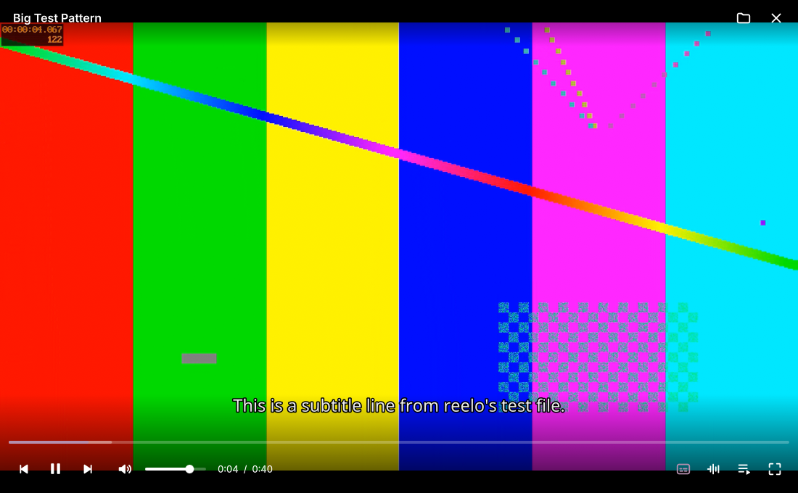

# reelo

uQ's media player: mpv's engine in a Qt Quick window that follows the uQ theme, with MPRIS.

reelo plays videos, music and streams with libmpv (so every format mpv plays), in a window that
takes its colours, corners and fonts from uQ's theme and changes with it live. It shows up in
uQ's media controls, `playerctl` and your media keys, resumes where you stopped, and plays the
next file in the folder.



## What it does

- **Plays anything mpv plays**: local files, folders, and streams or video pages (`https://…`,
  with yt-dlp for sites like YouTube). Hardware decoding when the card can.
- **Start screen**: the newest videos and music in your library folder (`~/Downloads` by default,
  where AV Morning Star and hauler save), one click to play, "Play all" for the lot.
- **Queue**: opening one file queues the rest of its folder in natural order (`ep2` before
  `ep10`); drop more files on the window with Shift to add them.
- **One window**: opening a file while reelo is open plays it in that window and brings it
  forward (`reelo --new-window FILE` opens a second player).
- **Resume**: closing a file remembers where you were (mpv's watch-later), and a file that played
  to the end is forgotten.
- **Subtitles and audio tracks**: matching subtitle files load by themselves; pick tracks from
  the bar or cycle them with `V` and `A`; preferred languages in the settings.
- **Music**: title, artist and album from the file's tags when there's no picture.
- **MPRIS 2**: play, pause, seek, next, previous, volume, rate, open URI, raise, quit and full
  screen, so uQ's media widget and `playerctl` control it.
- **Keeps the screen on** while a video plays (org.freedesktop.ScreenSaver, which hypridle honours).
- **uQ Settings page** (Apps › Media player): default player, playback, subtitles and library.

## Keys

| Key | Does |
|---|---|
| Space, K, right-click | play / pause |
| ← → / J L / Shift+← → | back / forward 5 s, 10 s, 1 min |
| ↑ ↓, wheel | volume |
| M | mute |
| F, F11, double-click | full screen (Esc leaves) |
| N, P | next, previous (P restarts the file first) |
| V, A | next subtitle, next audio track |
| Q | the queue |
| [ ] Backspace | slower, faster, normal speed |
| , . (paused) | frame back, frame forward |
| Ctrl+O, Ctrl+L | open files, open an address |
| Ctrl+W, Ctrl+Q | back to the start screen, quit |

## Command line

```
reelo [FILE|FOLDER|URL]...      play them (reelo -- FILE when a file is called "config")
reelo config show [--json]      every setting with its value and default
reelo config set KEY VALUE      resume, autoplay_next, keep_awake (true/false),
                                hwdec, subtitles (auto/off), sub_lang, audio_lang (en,eng),
                                library (~/Downloads)
reelo config reset KEY
reelo default status [--json]   is reelo the default for video and audio?
reelo default set               make it so (in ~/.config/mimeapps.list)
reelo library [--json]          the newest media in the library folder
```

Settings live in `~/.config/reelo/config.json`; resume positions in
`~/.local/state/reelo/watch_later/`. reelo reads none of `~/.config/mpv`, so an mpv.conf can't
break the window.

## Building

Needs Qt 6.5+ (Base, Declarative, SVG) and libmpv 2.

```
cmake -B build -G Ninja -DCMAKE_BUILD_TYPE=Release
cmake --build build
ctest --test-dir build                       # core tests
node --test 'tests/**/*.test.mjs'            # window helpers and the uQ page's logic
QT_QPA_PLATFORM=offscreen qmltestrunner -import tests/uq/stub -input tests/uq/tst_page.qml
sh tests/gui/smoke.sh build                  # plays a file under Xvfb, checks MPRIS
```

On Arch: `paru -S reelo` (AUR). Releases are tagged by CI when `VERSION` changes on main.

## Licence

GPL-3.0-or-later (libmpv as built by most distributions is GPL).
